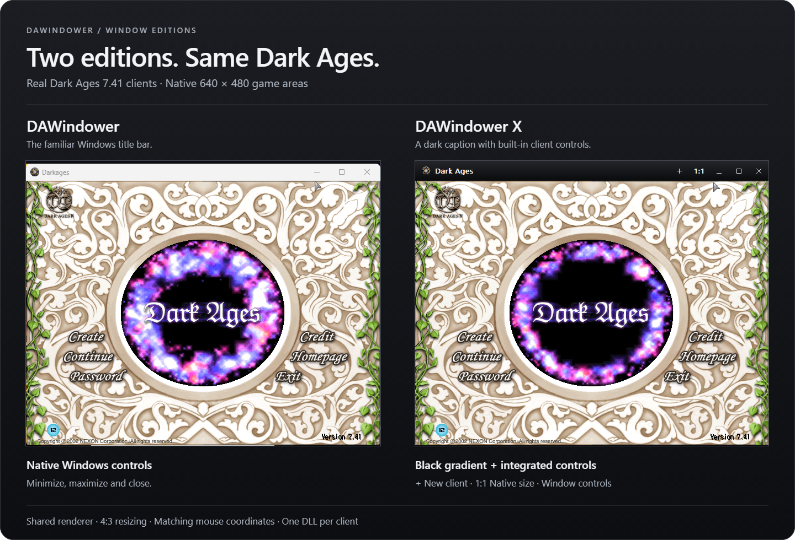

# DAWindower

**Dark Ages on your desktop. One DLL per client.**

An open-source alternative to `dawnd.dll`, with automatic rendering recovery
and an optional edition with extra window controls.

[Get started](#get-started) · [Performance](#why-we-changed-resized-rendering) · [Launcher guide](docs/integration.md) · [Contribute](CONTRIBUTING.md)

Real 7.41 clients. Shared gradient caption. Matching 640×480 game areas. <a href="docs/images/README.md">Capture details and build versions.</a>

## Familiar game. A stronger foundation.

- **Recover automatically.** Per-window rendering recovery after desktop
  interruptions, including background clients.
- **Resize naturally.** Native 640×480 startup, smooth 4:3 resizing and matching
  mouse coordinates.
- **Make it your own.** MIT-licensed C++17, readable source and native regression
  tests. No hooks into networking, gameplay or automation.

Native **32-bit Windows**. Each edition is **one standalone DLL**, using only
Windows system components. No proxy DLL, configuration files or extra runtime.

## Choose your edition

**Standard stays barebones:** familiar dawnd-style rendering and windowing for
launchers and other projects, with fixes for known rendering, recovery and window
bugs. **New features and extra controls go to X.** Core bug fixes and renderer
maintenance remain shared between both editions.

| Edition | What you get |
| --- | --- |
| **DAWindower** `DAWindower.dll` | Black gradient title bar with the client-supplied title and minimize, maximize/restore and close controls. |
| **DAWindower X** `DAWindowerX.dll` | Same title behavior, **+** New client, **1:1** native-size reset and button tooltips. |

Same renderer and recovery. Choose **one edition per client**.
Both editions preserve titles supplied by the game or launcher, including character
names when provided. Captions refresh from Windows title text, including updates
from another process; neither edition reads character-name buffers from game memory.
[X controls and title behavior →](docs/x-edition.md)

## Why we changed resized rendering

A report of sharply higher CPU usage after resizing led us to test smaller
windows. Shrinking the game area from **640×480 to 639×479** increased measured
CPU time per frame from **2.34 ms to 25.78 ms—about 11× the work for a one-pixel
shrink**. Even **636×477**, an exact 4:3 size, took 24.34 ms. Small resized windows
were taking a disproportionate amount of CPU, especially costly with multiple
clients running.

The expensive path combined the game's 16-bit RGB565 color conversion with
Windows' image shrinking. The **0.2.3 source candidate** keeps the game's native
canvas and software cursor, converts each completed frame into a reusable
32-bit image, then lets Windows scale that image. This makes downscaling cheaper
while preserving the original colors and nearest-neighbor sampling. Both editions
use this path, and you can keep your chosen window size.

Measured **process CPU milliseconds per frame**, including capture, conversion
and presentation; lower is better:

| Game area | Previous standard | New standard | New X |
| --- | ---: | ---: | ---: |
| 640×480 | 2.34 | 1.60 | 1.45 |
| 639×479 | 25.78 | **2.46** | **2.38** |
| 636×477 | 24.34 | **2.46** | **2.27** |
| 641×481 | 2.38 | 1.60 | 1.60 |
| 800×600 | 2.42 | 1.91 | 2.03 |
| 960×720 | 2.54 | 1.37 | 2.03 |

The reproduced 639×479 case uses **about 90% less CPU per frame** after the
change. These are local synthetic benchmarks of the actual packaged DLLs, with
two 200-frame measured passes per size. They are not FPS measurements or a
promise of the same CPU percentages in every live game session.

All 65,536 RGB565 colors and output sampling were checked against Windows'
previous output at six sizes. **90 local checks passed** across standard/X and
Release/Debug, including cursor composition and rendering recovery. The reusable
buffer adds about **1.17 MiB per window**.
[Full measurements, package hashes and validation scope →](docs/scaling-validation.md)

## Get started

**Current source: 0.2.3 candidate.** [Build either edition](docs/development.md)
or get candidate packages from [GitHub Actions](https://github.com/BuildWithRaymond/DAWindower/actions/workflows/ci.yml?query=branch%3Amain).

**Earlier download:** [v0.2.2 standard preview](https://github.com/BuildWithRaymond/DAWindower/releases/tag/v0.2.2)
predates X and the current resize, title-bar and presentation changes.

For launcher developers, replace your dawnd resource or injection path with
the chosen DLL:

1. Create Dark Ages suspended.
2. Inject the absolute DLL path with **`LoadLibraryA`** and wait for success.
3. Resume the client. **No extra initialization call.**

No specific launcher is required. [Integration details](docs/integration.md)
cover ordering, fixed filenames and fullscreen behavior.

Tested with actual Dark Ages **7.41** clients.
[Verification and limits →](docs/images/README.md#runtime-checks)

## With love for dawnd

For more than twenty years, dawnd has helped this community play Dark Ages in
windows and run multiple clients. Thank you to **Saraet, creator of dawnd.dll**,
and everyone who kept it in players' hands.

DAWindower carries that legacy forward with recoverable rendering, open source
and optional X controls. [Full credits →](CREDITS.md)

---

[Contribute](CONTRIBUTING.md) · [Code tour](docs/architecture.md) · [Testing](docs/testing.md) · [All docs](docs/README.md) · [MIT license](LICENSE)
