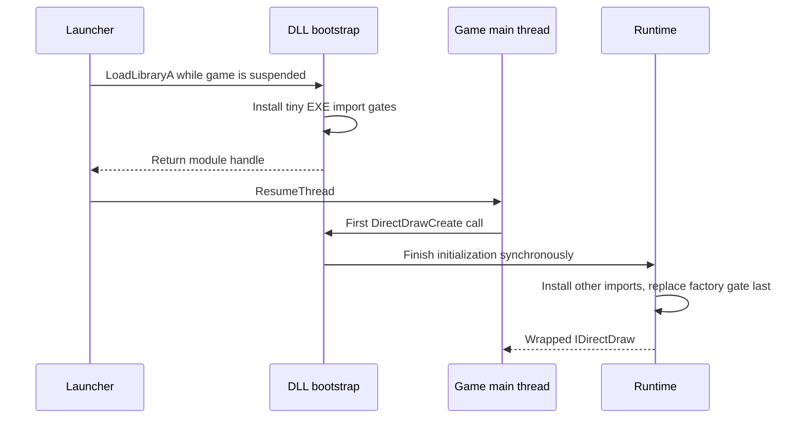
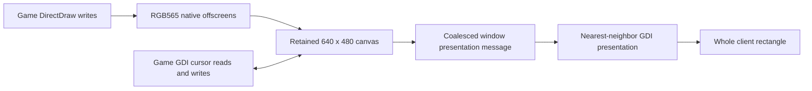

# A tour from DLL load to pixels

Read this before changing initialization, COM ownership or presentation. The
renderer deliberately keeps the game's native RGB565 offscreens; it changes how
the completed logical frame reaches the desktop.

## Source map

| Responsibility | Files | Main contract |
| --- | --- | --- |
| Entry points and runtime setup | [main.cpp](../src/main.cpp), [runtime.h](../src/runtime.h), [public exports](../include/dawindower.h) | Setup outside loader lock; optional exports are not launcher requirements. |
| Early loading gates | [bootstrap.cpp](../src/compatibility/bootstrap.cpp) | Fixed storage, bounded reads and Kernel32-only pointer swaps in process attach. |
| Import hooks and singleton adapter | [imports.cpp](../src/compatibility/imports.cpp), [mutex.cpp](../src/compatibility/mutex.cpp) | Replace only the expected import; isolate only the verified game mutex. |
| Device and surface wrappers | [draw.cpp](../src/graphics/draw.cpp), [surface.cpp](../src/graphics/surface.cpp) | Public COM identity survives native backing repair. |
| Logical GDI/cursor writes | [gdi.cpp](../src/graphics/gdi.cpp) | Game reads and writes logical pixels, including when the window is scaled or occluded. |
| Window lifetime and presentation | [window.cpp](../src/window/window.cpp), [window.h](../src/window/window.h) | Per-window canvas, queued presentation, desktop recovery hints and native frame cursors. |
| Size/input math and retries | [geometry.cpp](../src/window/geometry.cpp), [sizing.cpp](../src/window/sizing.cpp), [retry.h](../src/graphics/retry.h) | One transform for pixels and input; bounded retry scheduling. |

## Loading and initialization

`DllMain` calls `armBootstrap`, not the full initializer. The bootstrap uses no
containers, application locks, User32/GDI/COM calls, DLL loading or worker thread.
An earlier Kernel32-only `CreateMutexA` gate handles the game's singleton check.

The graphics gate calls the initializer on the game's normal factory call.
`main.cpp` loads the system DirectDraw by an absolute system-directory path,
pins the module, installs the other hooks and atomically replaces the factory
gate last. A failure returns an error instead of creating an unwrapped object.
No startup worker races the main thread.

Import replacement compares the current pointer with the expected target. Hook
restoration also compares ownership; it must not overwrite an unrelated hook.
Full initialization must never be moved into process attach. See Microsoft's
[DLL initialization guidance](https://learn.microsoft.com/en-us/windows/win32/dlls/dynamic-link-library-best-practices).

## Frames and cursor composition

`Draw::CreateSurface` turns a requested primary into a system-memory offscreen
surface wrapped by `Surface`. The public caps retain the game's expected role.
Ordinary offscreens keep native drawing behavior; the retained window canvas is
the logical frame used for final presentation and cursor operations.

`Surface::present` captures completed native primary pixels and queues presentation.
The EXE's `BitBlt` import goes through `windowBitBlt`, which redirects tracked
window-DC reads and writes to their logical canvases. The game can save/restore a
cursor background without reading scaled pixels from an occluded desktop window.

`requestPresentation` posts one outstanding message per window. That queued
boundary lets adjacent frame, cursor-erasure and cursor-draw writes finish before
painting. Recovery retries use the same boundary. Painting a failed display
operation immediately from an unrelated timer could reintroduce flicker.

A desktop presentation failure must not ask the game to repeat an already
completed `Flip`, `Unlock`, `ReleaseDC` or successful drawing operation. The
retained frame, not the game transaction, is retried.

## Recovery and object lifetime

| Object/reference | Owner and lifetime |
| --- | --- |
| `Draw` wrapper | COM reference count; owns a native DirectDraw reference and recovery binding. |
| `Surface` wrapper | COM reference count; owns its native surface and retains its `Draw`. The registry is keyed by public wrapper pointers; registry/`primary` entries are weak. |
| Emulated backbuffer | The front wrapper owns an attachment reference. Returning it adds a reference for the caller. |
| `WindowState` | Shared by the device and attached subclass; owns the DIB, canvas DC and retained pixels. |
| Window registry | Weak `WindowState` entries, removed when the window is destroyed. |
| `RecoveryBinding` | Shared by `Draw`, weakly referenced by the window; guards a nullable `Draw*` with a lifetime lock. |
| `PixelStore` | CPU snapshot shared by duplicate surfaces; revision numbers synchronize replaced native backing. |

Completed offscreen writes update CPU snapshots. Writable `Lock` leases remember
their committed region before unlock; `ReleaseDC` snapshots released content.
Color keys and applicable clippers are retained for restoration/recreation.
The ordinary virtual primary uses the retained canvas, and flip chains retain
distinct buffer content.

Recovery first restores native backing and repopulates pixels. After repeated
restore failures it can replace the native backing while keeping the public
wrapper address, COM identity and attachment reference stable. Native `Restore`
alone does not reload bitmap content; see Microsoft's
[surface restoration contract](https://learn.microsoft.com/en-us/windows/win32/api/ddraw/nf-ddraw-idirectdrawsurface7-restore).

Outstanding native locks or HDC leases prevent backing replacement. Unknown,
uncommitted writes lost during a lease cannot be recreated. A permanently cached
invalid HDC cannot be repaired by returning a different handle behind the caller's back.

Each window has a 100 ms timer; its recovery binding uses nonblocking lock attempts
and services at most four due surfaces per tick. Per-surface and presentation
backoff increases from 100 ms to a 2-second cap. A one-second input-desktop check
detects secure-desktop changes even when that game window is in the background.
Session/display/device/power/activation messages supply additional hints.

## Locking and reentrancy

- `Draw::mutex` guards its surface registry, weak primary and surface state.
  Surface operations can take the canvas lock while holding this recursive mutex.
- `WindowState::lock` protects canvas pixels and shared HDC access. The GDI bridge
  releases the registry mutex before acquiring canvas locks. Two canvases are
  locked in a consistent pointer order.
- Timer recovery tries the binding lifetime lock and owner mutex; it skips work
  rather than waiting for a rendering operation.
- Host window callbacks can synchronously destroy their HWND. Attachment retains
  its binding until style/position calls return; paint/minmax callbacks retain
  shared state and recheck the window after calling the host.
- Window presentation, timer/backoff and frame-cursor state belong to the window
  thread. Do not introduce a worker that paints or changes cursor counts from
  another thread.

## Window and input behavior

The subclass makes the existing top-level window resizable. Windows supplies
normal tracking limits; there is no custom aspect-ratio or size grid. The logical
640×480 image fills any positive client size, independently on each axis.
Nearest-neighbor scaling preserves source colors but noninteger scale factors
necessarily produce uneven destination pixel widths/heights.

`viewport` and `toGame` are the single geometry contract. Button presses outside
the image are excluded. Wheel messages retain their Win32 screen-coordinate ABI
after logical coordinate mapping. DPI changes use the suggested rectangle only
for windows that receive that DPI-aware message; process DPI awareness is not
changed after window creation.

`FrameCursor` uses native system resize shapes. It borrows only the visibility
increments needed over a border or during a resize drag, then balances only its
own calls. The host still owns client-area cursor messages. It must not force a
guessed `ShowCursor` baseline or add an OS cursor over the game's software cursor.

For exact loading details, read [integration](integration.md). For historical
implementation choices, read [the recovery design](standalone-recovery-design.md).
