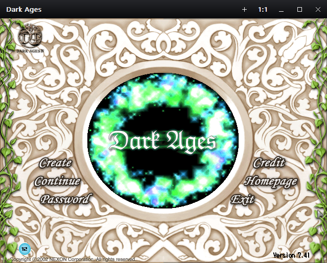

# DAWindower X

X adds window controls to DAWindower's existing renderer. It is an optional
edition, distributed as **one `DAWindowerX.dll`**, with Windows system dependencies
only. Use one edition per client. Both editions share the gradient caption renderer,
host-controlled window title and loading contract. Standard `DAWindower.dll`
has three ordinary window controls; X adds two client actions.

[](images/x-native.png)

Actual 7.41 main menu before login, with a **640×480** game area.
[Original captures and comparison](images/README.md).

## Controls

| Control | Action |
| --- | --- |
| Game icon | Open the native Windows system menu. The icon comes from the game executable; launcher-supplied icons take precedence. |
| + | Start another `Darkages.exe` from this client's game folder and inject the same X DLL before resuming startup. |
| 1:1 | Restore the window if maximized, then set the actual game client rectangle to 640×480. |
| − / □ / × | Windows minimize, maximize/restore and close commands. |
| Empty title bar | Native window move, double-click maximize and system menu behavior. |

The caption uses a restrained charcoal-to-black gradient, light semibold text,
the game icon, rounded hover states and descriptive dark tooltips on every button. There is no
visible side/bottom border. Invisible edge/corner hit regions keep resizing
available. The caption follows Windows high-contrast system colors. The two
extra actions also appear in the
Windows system menu (Alt+Space). Releasing outside a pressed button cancels it.
Title-bar clicks are consumed before the game's input-coordinate transform.

Both editions keep ordinary window resizing at native 4:3, with nearest-pixel
rounding. A launcher's bare-popup fullscreen selection owns monitor bounds and
suppresses X's caption/resize grips. Fullscreen fills the monitor, so non-4:3
monitors use independent horizontal/vertical scaling.

The New client action does not copy launcher command lines, credentials or
automatic-login state. It starts the same executable directly with its game
folder as working directory. One launch can be in flight per window. Waiting
for injection happens on a short-lived worker, never the game/UI thread. A failed
injection cleans up only its newly created suspended child. A red + and hover
text report the failed stage and Windows error; click again to retry.

Internal launch uses Unicode `CreateProcessW`/`LoadLibraryW` paths. Existing
launchers can still inject X with ordinary early **`LoadLibraryA` alone**, exactly
as described in the [integration guide](integration.md), substituting
`DAWindowerX.dll`. No additional exported call is required. The internal launch
transaction clones the running x86 executable and uses the same-bitness Windows
system-loader route tested by the development fixtures.

## Window title

Both editions display the title supplied by the game or launcher, including a
character name when the host provides one. The caption reads `GetWindowTextW` on
attachment and after forwarding each `WM_SETTEXT` to the host. This preserves the
accepted title, including text the host changes or rejects and intentionally empty
titles, while USER32 handles ANSI/Unicode conversion. The caption does not rewrite
the native window title. Captions also read window text on paint and once per
second, repainting when it changes, because external setters can update the stored
title without delivering `WM_SETTEXT` to this process.

Neither edition reads character-name buffers or polls game memory for titles.
Title handling needs no executable-specific character offset. X's separate
launch-completion timer runs only while its own New client worker is active.

## Build and package

From the repository root in Developer PowerShell:

```powershell
cmake --preset windows-x86-x
cmake --build --preset x-release
ctest --preset x-release
cmake --install build/windows-x86-x --config Release
python tools/check_package.py dist/local-x --edition x
```

The package contains only `dist/local-x/DAWindowerX.dll`. Debug uses `x-debug`.
No-desktop checks use `x-unit-release` / `x-unit-debug`; they do not exercise
rendering, title-bar interaction or child injection. Both editions use the Windows
`DWMAPI.dll`, `UXTHEME.dll` and `MSIMG32.dll` components for their shared caption;
none is distributed.

## Code and validation

- [Shared caption](../src/window/caption.cpp): non-client painting, hit regions, UI lifetime,
  tooltip/menu actions and asynchronous launch ownership.
- [Launch transaction](../src/x/launch.cpp): suspended child, injection, resume and failure cleanup.
- [Approved design](designs/2026-10-14-dawindower-x.md): scope and implementation sequence.

The existing rendering, recovery, cursor and resizing contracts run for both
editions, including ANSI/Unicode caption and accepted-title contracts. X adds extra frame controls
and synthetic child-launch contracts. A
synthetic fixture proves injection ordering and UI wiring, not retail gameplay
or host-specific login-title timing. Earlier prototype name-reader observations
are historical; the current title behavior uses only window text. The user confirmed native reset,
New client and normal graphics/input on the initial X prototype. Later actual
checks confirmed retained title bars, smooth resizing, native-size startup and
all five corrected tooltips. Exact build scopes and remaining transition tests:
[current validation record](x-borderless-validation.md).
